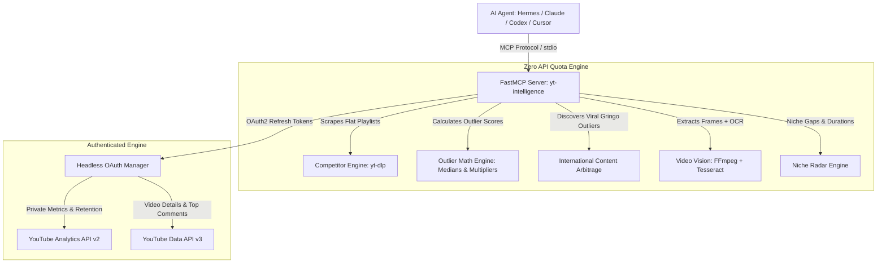

<div align="center">

# 🎯 YouTube Intelligence MCP

**A powerful, self-hosted vidIQ alternative & YouTube channel command center for AI Agents.**  
*Zero-quota competitor scraping, mathematical outlier detection, on-screen video vision OCR, international content arbitrage, and private channel analytics via OAuth2.*

[](https://opensource.org/licenses/MIT)
[](https://www.python.org/)
[](https://modelcontextprotocol.io/)
[](#mcp-client-setup)

</div>

---

## ⚡ Why This Exists (The Problem with Traditional Tools)

Traditional YouTube intelligence platforms (like vidIQ or TubeBuddy) charge **$40 to $100+/month**, lock your historical data behind walled gardens, and give generic AI suggestions. 

On the engineering side, building on the official **Google YouTube Data API v3** carries a critical trap: **the 10,000 units/day quota limit** (a single search consumes 100 units, hitting rate-limits in minutes).

**YouTube Intelligence MCP** solves this with a **Hybrid Engine Architecture**:
1. **Competitor & Market Intelligence (Zero Quota):** Fast flat-playlist scraping via `yt-dlp` extracts views, engagement, and metadata without spending a single Google API quota unit.
2. **True Outlier Math:** Uses sample-median baseline calculation ($Multiplier = \frac{Views}{Median(Views_{last20})}$) to separate genuine breakout videos ($2.5\times$ to $25\times$) from channel subscriber momentum.
3. **AI Video Vision & OCR:** Extracts keyframes with FFmpeg and reads on-screen code, terminal commands, slides, and editor tabs using local Tesseract OCR.
4. **International Content Arbitrage:** Automatically discovers foreign breakout videos in your niche (e.g. US/EU creators with 20k subs getting 1M views) and adapts titles/hooks for the local market.
5. **Private Channel Audit (via Google OAuth):** Securely connects your channels to pull watch time, average retention %, CTR, and traffic source distribution (Search vs Browse/Suggested).

---

## 🏗️ Architecture



---

## 🛠️ MCP Tools Catalog

This server exposes 9 comprehensive tools ready for any MCP-compliant client:

| Tool Name | Description | Data Source | Quota Cost |
|---|---|---|---|
| `yt_search_flexible` | Ultra-flexible YouTube search engine (filter by today, this week, view count, length, channel vs video, min/max views). | yt-dlp | **0** |
| `yt_analyze_competitor` | Computes baseline median views and identifies outlier breakout videos for any channel. | yt-dlp | **0** |
| `yt_detect_outliers` | Returns only breakout videos exceeding the channel's performance threshold ($2.0\times+$). | yt-dlp | **0** |
| `yt_compare_competitors` | Side-by-side benchmark comparing subscribers, median views, and top breakout videos across 2-5 channels. | yt-dlp | **0** |
| `yt_mine_viral_gringo_ideas` | Mines international viral videos in a niche and generates high-CTR localized angles and hooks. | Arbitrage Engine | **0** |
| `yt_niche_radar` | Scans a topic to detect dominant channels, winning keywords, and optimal video duration. | Niche Engine | **0** |
| `yt_video_deep_dive` | Extracts hidden creator tags, engagement rates (like/comment ratios), and audience questions. | Google API / yt-dlp | Minimal |
| `yt_inspect_video_visuals` | Extracts key visual frames via FFmpeg and runs OCR to read code, slides, and editor text on screen. | FFmpeg + OCR | **0** |
| `yt_channel_audit_report` | 30-day channel diagnostic: average retention %, subscriber conversion velocity, and traffic sources. | YouTube Analytics API | Minimal |
| `yt_my_channel_overview` | Real-time overview of your connected channel (subscribers, views, recent uploads). | YouTube Data API | 1 unit |

---

## 🚀 Quickstart

### 1. Installation

```bash
# Clone the repository
git clone https://github.com/LucasOliveira09/yt-intelligence-mcp.git
cd yt-intelligence-mcp

# Create virtual environment and install dependencies
python3 -m venv .venv
source .venv/bin/activate
pip install -r requirements.txt
```

### 2. Standalone CLI Usage

The repository includes a rich terminal CLI for quick research without launching an agent:

```bash
# 1. Analyze any competitor channel for outliers (Zero Quota)
python -m src.cli analyze @BeroODev --limit 20

# 2. Mine international viral content opportunities (Content Arbitrage)
python -m src.cli arbitrage "GTA 6" --views 50000

# 3. Flexible search with filters (e.g., videos posted today, sorted by views)
python -m src.cli search "AI agents" --period this_week --sort view_count --limit 10

# 4. Connect your own YouTube channel via Google OAuth
python -m src.cli add-account my_channel
```

---

## 🤖 MCP Client Setup

### A. Hermes Agent (`~/.hermes/config.yaml`)

```yaml
mcp_servers:
  yt-intelligence:
    command: /path/to/yt-intelligence-mcp/run_server.sh
    enabled: true
```

### B. Claude Desktop (`claude_desktop_config.json`)

```json
{
  "mcpServers": {
    "yt-intelligence": {
      "command": "/path/to/yt-intelligence-mcp/.venv/bin/python",
      "args": ["-m", "src.server"],
      "cwd": "/path/to/yt-intelligence-mcp"
    }
  }
}
```

### C. Cursor (`.cursor/mcp.json`)

```json
{
  "mcpServers": {
    "yt-intelligence": {
      "command": "/path/to/yt-intelligence-mcp/run_server.sh"
    }
  }
}
```

---

## 🔐 Security & Privacy Posture

- **Zero Credential Leaks:** Refresh tokens and OAuth credentials are saved strictly to `data/accounts.json` with `chmod 600` permissions and are permanently ignored in `.gitignore`.
- **Safe VPS Execution:** Temporary video streams downloaded for frame extraction are deleted immediately after keyframe capture to prevent disk consumption.
- **Local First:** Runs 100% on your own hardware or VPS over stdio without third-party telemetry.

---

## 📄 License

Distributed under the [MIT License](LICENSE). Built by **Lucas Leite de Oliveira**.
